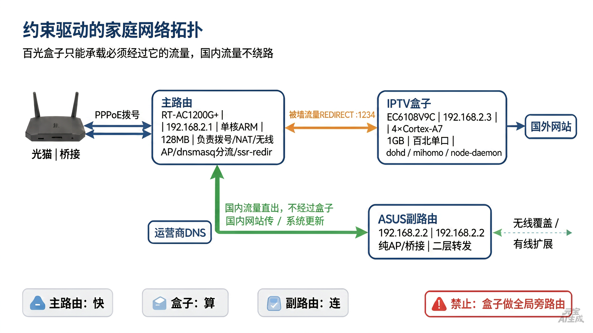

# k2p-b1-ssr-to-ubuntu-mihomo-edge

**K2P B1（SSR / `ssr-redir`）→ Ubuntu 盒子（`mihomo`）反向串联的家庭网络工程复盘。**

一份**家庭局域网工程复盘**：在「K2P B1（华硕系固件）+ 一台百兆网口 Ubuntu 机顶盒」这套既有的、没法换的硬件上，如何把**边界路由 / 域名解析 / 出口转发**拆成三层职责，并把配置持久化、防回环、故障自愈这几件事做稳。

> 这是工程笔记，不是部署包，也不是资源仓库。
> 所有 `*.example` 中的 IP 一律使用 RFC 5737 文档保留段（`192.0.2.0/24`），域名使用 RFC 2606 保留域（`example.com` / `example.net` / `example.invalid`）。
> 动手之前先读 [DISCLAIMER.md](DISCLAIMER.md)。

## 0. 一眼看懂：两台机器各干什么

**路由器负责边界与分流规则，盒子负责解析与出口；百兆盒子永远不进内网转发路径。**

| 层 | 跑在哪 | 关键组件 | 职责 |
| --- | --- | --- | --- |
| 边界层 | K2P B1（华硕系固件） | `dnsmasq` + `ipset` + HWNAT + `ssr-redir` | NAT、DHCP、唯一 DNS 入口、集合填充、透明转发 |
| 解析层 | 盒子 Ubuntu (ARM) | `pdnsd` / `dohd` | 上游解析，只接受来自路由器的查询 |
| 出口层 | 盒子 Ubuntu (ARM) | `mihomo` | 本地转发端口，只对路由器源地址开放 |

这套分工最大的特点是**不对称**：路由侧是轻量的 `dnsmasq` + `ssr-redir`，盒子侧是完整的 `mihomo` + 独立解析器。两边配置互不复制，任何一侧重装都不影响另一侧。

## 1. 硬件与约束

| 角色 | 硬件 | 真正的瓶颈 |
| --- | --- | --- |
| 边界路由 | K2P B1，华硕系固件（`nvram` 体系，squashfs 只读根） | 16MB flash / 256MB RAM，无插件空间；主配置由固件 rc 重建 |
| 解析与出口 | 机顶盒刷 Ubuntu（ARM，百兆 RJ45，双核） | 网口是**百兆全双工**，单臂旁路时上下行共享 100Mbps |
| 终端 | 有线 + 2.4G/5G 无线 | 无线侧实际吞吐远低于理论值 |

两个硬结论先放这里：

1. **盒子不能当默认网关。** 百兆网口 + 单臂旁路 = 每个包两次过线，实测有效吞吐只剩理论值的一半左右。让盒子承载"所有内网流量"是纯带宽工程上的错误，跟软件优化无关。详见 [ADR-001](docs/ADR.md#adr-001-盒子不做默认网关)。
2. **把职责放在哪一层，比把配置写对更重要。** 边界层只做它必须做的事（NAT / DHCP / 首个 DNS 入口 / 集合填充），盒子只做边界层做不到的事。

## 2. 三层职责

- **边界层（K2P）**：WAN 拨号、NAT、DHCP、HWNAT、`dnsmasq` 作为局域网唯一 DNS 入口、`ipset` 集合填充、`ssr-redir` 负责命中集合后的透明转发，以及对盒子的**限源**访问控制。
- **解析层（盒子 Ubuntu）**：`pdnsd` / `dohd` 只监听回环或内网，只接受**来自边界层**的查询；单实例守卫保证重启不会叠进程。
- **出口层（盒子 Ubuntu）**：`mihomo` 的本地转发端口（HTTP / SOCKS / 透明）只对边界层的源地址开放，其余一律拒绝。

拓扑与数据流见 [topology/topology.svg](topology/topology.svg)（源图 [topology.drawio](topology/topology.drawio)，可自行改）。
真实环境截图（含真实内网网段与设备型号，仅作对照，不用于实际部署）：



## 3. 一次域名解析的完整路径

```
终端 → K2P:53 (dnsmasq)
        ├─ 命中 ipset 规则 → 加入集合，返回上游应答
        └─ 未命中         → 转发 192.0.2.3#5353 → 盒子解析层
                                       └─ 按规则决定走直连还是出口层
终端 → K2P (TCP) → 命中集合的目的一律转给盒子出口端口 → 分流出口
```

关键设计点：**边界层永远是终端唯一看到的 DNS 与网关**。盒子换实现、重启、升级，终端侧配置零改动。

## 4. 仓库结构

```
k2p-b1-ssr-to-ubuntu-mihomo-edge/
├── README.md
├── DISCLAIMER.md                     # 单独一页，出事时唯一能证明"没有分发意图"的书面材料
├── LICENSE                           # MIT
├── .gitignore                        # 第一个 commit 就有
├── .githooks/pre-commit              # 提交前扫凭证与协议链接
├── setup-hooks.sh                    # git config core.hooksPath .githooks
├── topology/
│   ├── topology.svg                  # 三层职责与数据流
│   └── topology.drawio               # 源图
├── merlin/
│   ├── dnsmasq.conf.add.example      # 片段写法 + 重复关键字反例
│   ├── nat-start.example             # 只有 iptables 骨架，默认不执行
│   └── hwnt-check.sh                 # 只读核对 HWNAT 开关
├── ubuntu-box/
│   ├── nftables.conf.example         # 只含限源防御规则
│   ├── dohd.env.example              # 上游全部为占位符
│   ├── mihomo/
│   │   ├── config.yaml.schema        # 只给字段说明，proxies 为空
│   │   └── rules.example.yaml        # 只给 DNS / 分流规则骨架
│   └── systemd/
│       ├── node-daemon.service
│       └── node-daemon.sh.example    # 探活状态机，数据源由使用者自备
├── tests/
│   ├── dnsmasq-selftest.sh           # --test 前置自检 + 重复关键字检测
│   └── loopback-guard.sh             # 核对“先放行、后重定向”的回环保护
└── docs/
    ├── ADR.md                        # 六条架构决策
    └── pitfalls.md                   # 七个真踩过的坑
```

## 5. 关键决策速查

| 编号 | 决策 | 一句话理由 |
| --- | --- | --- |
| [ADR-001](docs/ADR.md#adr-001-盒子不做默认网关) | 盒子不做默认网关 | 百兆单臂旁路，吞吐直接腰斩 |
| [ADR-002](docs/ADR.md#adr-002-dns-分流在边界层终结) | DNS 分流在边界层终结 | 终端只认一个入口，盒子可随时替换 |
| [ADR-003](docs/ADR.md#adr-003-持久化走-jffs--bind-mount) | 持久化走 `/jffs` + bind mount | squashfs 只读，改原文件重启即失效 |
| [ADR-004](docs/ADR.md#adr-004-dnsmasq-定制只走-conf-dir-片段) | dnsmasq 定制只走 conf-dir 片段 | 主配置会被固件 rc 重建 |
| [ADR-005](docs/ADR.md#adr-005-上游解析器必须单实例) | 上游解析器必须单实例 | 多实例时会抢端口、放大查询 |
| [ADR-006](docs/ADR.md#adr-006-探活与热更只公开契约) | 探活与热更只公开契约 | 状态机是工程，数据源不是 |

## 6. 自检脚本（全部只读，不会重启任何服务）

```sh
# DNS 配置语法 + 片段重复关键字
sh tests/dnsmasq-selftest.sh -d /jffs/configs/dnsmasq.d

# 回环保护：盒子的源地址是否在重定向前被放行
sh tests/loopback-guard.sh 192.0.2.3

# HWNAT 开关核对
sh merlin/hwnt-check.sh
```

三个脚本都只读取现状并打印 `PASS / WARN / FAIL`，不写配置、不 reload、不重启。建议改完配置先跑一遍，再决定要不要动服务。

## 7. 这个仓库里没有什么

- 没有任何节点、订阅、机场、邀请码、转换接口
- 没有任何一键部署 / `curl | sh` 脚本
- 没有任何域名全量名单（`gfwlist` 类数据请自行从上游项目按其许可获取并本地生成）
- 没有任何固件、镜像或构建产物
- 没有任何真实内网拓扑截图、MAC、序列号、拨号账号

理由很直接：**工程复盘可以公开，资源分发不能公开**。这两件事在平台判定上属于完全不同的性质。

## 8. 许可

原创部分 MIT，见 [LICENSE](LICENSE)。文中提到的 `mihomo` / `dnsmasq` / `pdnsd` / `Entware` 等版权归各自作者，本仓库仅做配置范式说明，未再分发其二进制或源码。
